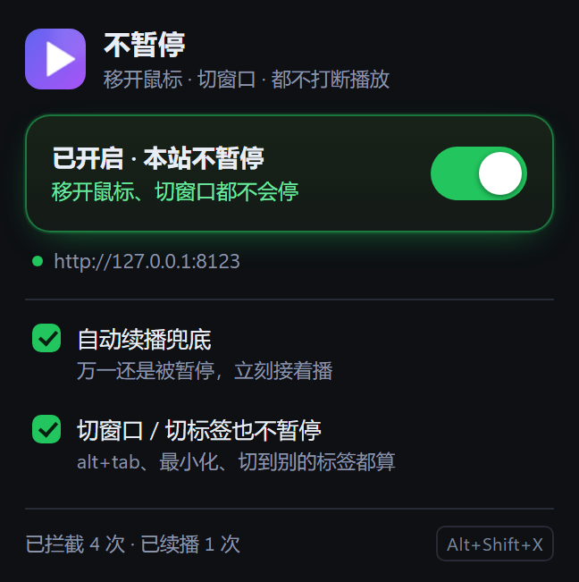

# 不暂停 · 移开鼠标照样播（Edge 扩展）

一个专门干掉「**鼠标一移开视频就暂停**」这类流氓行为的 Edge 扩展。

装好后默认对所有网站在线生效：**不用点，打开网页就已经在保护了**。想看状态、想对某个站点关掉，点一下工具栏图标就行。

> 本扩展是「网课解决方案」的一部分。仓库根目录还有配套的**置顶播放监控条**——
> 扩展负责「别误停」，监控条负责「真停了要发现」，两个可以一起用。



---

## 一、安装（30 秒）

Edge 只能「加载解压缩的扩展」来装这种非商店扩展，步骤固定：

1. 把 `nopause-edge` 整个文件夹放到一个**不会被删、不会移动**的位置，例如 `D:\Tools\nopause-edge`。
   （扩展运行时会一直读这个目录，装完就删/挪文件夹会直接失效。）
2. 地址栏打开 **`edge://extensions/`**
3. 打开左下角（或右侧）的 **「开发人员模式」** 开关
4. 点 **「加载解压缩的扩展」**，选中 `nopause-edge` 这个文件夹（**选文件夹本身，不是里面的文件**）
5. 列表里出现「不暂停 · 移开鼠标照样播」就装好了
6. 建议点工具栏的拼图图标 🧩，把「不暂停」**固定到工具栏**，方便随时开关

> 每次重启 Edge 可能会弹一句「请停用以开发人员模式加载的扩展」——那是 Edge 对非商店扩展的例行提示，点 × 关掉即可，不影响使用。

---

## 二、怎么用

| 操作 | 效果 |
| --- | --- |
| 直接上网 | 已自动生效，视频不会因为鼠标移开/切窗口而停 |
| 点工具栏图标 | 弹出面板：大开关控制**当前网站**，改动立即生效，不用刷新 |
| `Alt+Shift+X` | 一键开关**当前网站**（不用打开面板）。快捷键可在 `edge://extensions/shortcuts` 改 |
| 图标上的 `ON` / `OFF` 角标 | 当前站点处于开启 / 关闭状态 |

面板里的两个子选项（全局生效）：

- **自动续播兜底**（默认开）：万一某些站点用比较刁钻的方式把视频暂停了，扩展会在 0.2 秒内把它重新播起来。**你自己点的暂停不会被抢**（靠「刚点过播放器 / 鼠标还停在播放器上」两个信号判断）。
- **切窗口 / 切标签也不暂停**（默认开）：alt+tab、最小化、切到别的标签页都不停。关掉它就只防「鼠标移开」，切标签仍按站点本来的行为暂停。

---

## 三、它到底干了什么

原生 MV3 扩展，没有后台服务器，不收集任何数据，代码全部在这个文件夹里可以自己看。

`src/guard.js` 注入页面**主世界**（`world: "MAIN"`，`document_start`，比站点自己的脚本更早跑），分四层拆掉「移开就暂停」：

1. **事件层（主力）**：在 `window` 的**捕获阶段**监听 `mouseout / mouseleave / pointerout / pointerleave / blur / visibilitychange`。
   判断这个事件是不是「指针离开了播放器或整个窗口」，是就 `stopImmediatePropagation()` **直接吞掉**——站点注册的暂停处理器根本不会被调用。
   不是播放器相关的事件（比如页面自己的下拉菜单）原样放行，所以不会把网页搞坏。
2. **状态伪装层**：把 `document.hidden` 恒定返回 `false`、`visibilityState` 恒定 `'visible'`、`hasFocus()` 恒定 `true`。对付那些不监听事件、而是定时轮询「我是不是还在前台」的播放器。
3. **调用拦截层**：鼠标刚离开后的 0.6 秒内，`HTMLMediaElement.prototype.pause()` 直接失效，挡住站点从别的代码路径补的那一刀。
4. **兜底层**：监听所有 `pause` 事件，发现视频被暂停了（且不是用户操作的）就立刻 `play()` 续播，10 秒内最多救 8 次，不会和站点打无限回合。

`src/bridge.js` 是隔离世界的桥：读 `chrome.storage` 决定本站开不开，把配置用 `postMessage` 递给 guard，并把统计数字回传给弹窗。
`src/background.js` 只负责工具栏角标和快捷键。

**为什么不在页面里 `addEventListener` 补丁？** 因为捕获阶段的 `stopImmediatePropagation` 覆盖面更广：它连站点用 `element.onmouseleave = ...`、HTML 内联属性、以及第三方播放器库内部注册的监听器一起挡了。

---

## 四、适用与不适用

**有效的典型场景**：视频网站 / 网课平台 / 在线培训系统里「鼠标移出画面就暂停」「切走标签就暂停」「窗口失焦就暂停」的行为，包括播放器被包在跨域 iframe 里的情况（扩展会注入所有 frame）。

**可能无效的情况**（这些不属于「事件驱动暂停」）：

- DRM 流媒体（Netflix / Disney+ / 部分国内平台的付费片源）：播放控制由 Encrypted Media 层把着，自动续播可能被拒，控制台会显示续播失败计数。
- 播放器用 Canvas/WebGL 自绘、暂停逻辑写进 WASM 里并且不看 DOM 事件的站点。
- 站点主动检测「扩展存在」并拒绝播放——这种扩展救不了，属于对抗问题。
- `edge://` 内部页面、Edge 加载项商店、PDF 阅读器：浏览器不允许任何扩展注入。

如果某个站点被搞坏了（比如悬浮菜单不自动收起），点开面板把**本站**关掉即可，其他站点不受影响。

---

## 五、目录结构

```
nopause-edge/
├─ manifest.json          # MV3 清单
├─ src/
│  ├─ guard.js            # 主世界守卫（核心，四层拦截）
│  ├─ bridge.js           # 隔离世界桥接（storage ↔ 主世界）
│  └─ background.js       # service worker：角标 + 快捷键
├─ popup/                 # 弹窗界面（popup.html / popup.css / popup.js）
├─ icons/                 # 16/32/48/128 图标
└─ docs/popup.png         # 弹窗截图
```

## 六、怎么确认它真的生效

1. 打开任意一个「移开就暂停」的网课页面，开始播放；
2. 把鼠标移到浏览器窗口外 / 切到别的窗口 / 最小化 —— 视频应当**继续播**；
3. 点工具栏图标，把**当前网站**关掉，重复第 2 步 —— 这时应当按站点本来的行为**暂停**。

两次现象不一样，就说明扩展起作用了。状态看工具栏图标上的 `ON` / `OFF` 角标。

如果某个站点被搞坏（悬浮菜单不收、弹窗卡住），把本站关掉即可，其他站点不受影响。

